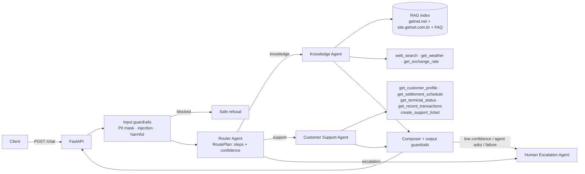

# Getnet Multi-Agent Support System

A multi-agent support service for Getnet merchants, exposed as one HTTP endpoint.

- **Router Agent** plans the work: one agent or an ordered sequence of agents.
- **Knowledge Agent** answers questions about Getnet products from a RAG index built on Getnet's
  official pages, and uses web tools (weather, exchange rates, web search) for general questions.
- **Customer Support Agent** resolves merchant-specific issues. Its tools read the merchant's own
  data: settlements, terminals, transactions. It can also open a ticket.
- **Human Escalation Agent** hands the case to a person when the system can't resolve it confidently.

It runs **with Claude** (Anthropic SDK: tool use + structured outputs) or **fully offline**
(deterministic heuristics + extractive answers). Tests, demos and evaluators therefore never need
an API key.

> Built with **Spec-Driven Development**. Read [`specs/`](specs/) first:
> [context & sources](specs/00-context-and-sources.md) ·
> [requirements](specs/01-requirements.md) ·
> [design](specs/02-design.md) ·
> [tasks](specs/03-tasks.md) ·
> [testing & evaluation](specs/04-testing-and-evaluation.md) ·
> [execution plan & coverage matrix](specs/05-execution-plan.md)

---

## 1. Build, configure, run

### Docker (recommended)

```bash
cp .env.example .env            # optional: set ANTHROPIC_API_KEY to enable LLM mode
docker compose up --build       # API on http://localhost:8000
```

Plain Docker: `docker build -t getnet-agents . && docker run -p 8000:8000 --env-file .env getnet-agents`

```bash
curl -s -X POST localhost:8000/chat -H 'Content-Type: application/json' \
  -d '{"message": "My card machine won'"'"'t connect to the internet, what should I do?", "user_id": "cliente1988"}'
./scripts/smoke.sh               # runs the 10 scenarios from the brief against the running API
```

OpenAPI docs: http://localhost:8000/docs · Health: http://localhost:8000/health (reports `mode`).

### Local

```bash
make install        # .venv + dependencies
make ingest         # build the RAG index (data/index/)
make run            # uvicorn on :8000
```

### Configuration (`.env`)

| Variable | Default | Meaning |
|---|---|---|
| `LLM_MODE` | `auto` | `auto` = Claude when a credential exists, otherwise **offline**; force with `llm` / `offline` |
| `ANTHROPIC_API_KEY` | — | Claude credential |
| `LLM_MODEL` / `ROUTER_MODEL` | `claude-opus-5-5` / `claude-haiku-5-5` | Model for the agents / cheaper, faster routing model |
| `LLM_TIMEOUT_S` | `30` | Per-call timeout (falls back to offline on errors) |
| `INGEST_ONLINE` | `0` | `1` also crawls the live Getnet pages in `data/sources.yaml` at build time |
| `RAG_TOP_K`, `RAG_MIN_SCORE` | `4`, `0.08` | Retrieval parameters |
| `ESCALATION_CONFIDENCE` | `0.45` | Below this confidence the request is handed to a human |

Mock merchants: `cliente1988` (bakery in Porto Alegre: one offline Get Smart, declined transactions,
settlements) and `cliente2024`. Any other `user_id` → the system asks for a human.

## 2. Tests and evaluation

```bash
make test           # 104 tests, fully offline (no key, no network: HTTP and LLM are faked)
make eval           # golden-set release gate
python -m app.evaluation   # prints the metrics report
```

| Layer | What it covers |
|---|---|
| Unit | Guardrails, PII masking, support/web tools, chunker, retriever, router heuristics, LLM tool loop (scripted fake SDK) |
| Contract | API schema, 422 validation, response shape, `X-Trace-Id` |
| Integration (orchestration) | Full request through guardrails → router → agent(s) → composition → output guardrails. Only the edges are replaced (fake LLM, mocked HTTP). Tests assert the **path** (route, agents, tools, sources, escalation), not only the text. Also covers failure injection: agent exception → 200 + handoff; LLM down → offline fallback |
| Evaluation | [`tests/evals/scenarios.yaml`](tests/evals/scenarios.yaml): the 10 brief scenarios + 6 adversarial cases (prompt injection, card cloning, human request, off-topic, PII, unknown user) |

Current offline report: **16/16 cases**. Routing, tool selection, groundedness, safety and
escalation precision are all at **100%**. The gates are ≥90%, ≥90%, ≥85%, 100% and ≥90%.
Strategy, LLM-as-judge and production monitoring:
[`specs/04-testing-and-evaluation.md`](specs/04-testing-and-evaluation.md).

## 3. Orchestration architecture



### Agents

| Agent | Responsibility | Tools | LLM mode | Offline mode |
|---|---|---|---|---|
| Router | Entry point. Classifies the message and plans one agent or a sequence | — | Structured output (`RoutePlan`) with `ROUTER_MODEL` | Transparent PT/EN keyword rules |
| Knowledge | Getnet product Q&A grounded in RAG with citations; general questions via web tools | `search_knowledge_base`, `web_search`, `get_weather`, `get_exchange_rate` | Cited answer from numbered chunks, with a tool loop over the web tools | Extractive: most relevant official sentences + sources |
| Customer Support | Resolves merchant issues using the merchant's data | 5 tools (table above) | Tool-use loop. Must succeed in at least one tool call, otherwise falls back | Intent → tools → templated answer with real numbers; opens a ticket for offline terminals |
| Human Escalation | Structured handoff to a human operator | `create_handoff_ticket` | — | Protocol + support channels |

### Message workflow

1. **Input guardrails** ([`app/guardrails/input.py`](app/guardrails/input.py)) mask CPF/CNPJ, card
   numbers, e-mail and phone before anything reaches an LLM or the logs. They also block prompt
   injection and harmful requests such as card cloning or fraud bypass.
2. **Router** returns a `RoutePlan`. An explicit request for a human always escalates, whatever the
   LLM says. If the LLM fails, the heuristics take over.
3. **Orchestrator** ([`app/orchestrator.py`](app/orchestrator.py)) runs each step with an
   `AgentContext`, which carries the masked message, the step instruction and the **outputs of the
   previous steps**. That context is the data flow between agents. Example: *"machine won't connect"*
   → Support finds the offline Get Smart, gives tailored steps and opens a ticket → Knowledge adds the
   official troubleshooting guidance.
4. **Composition**: with two or more agents, the Claude composer merges the outputs (offline:
   merchant diagnosis first, then "Official guidance").
5. **Output guardrails** ([`app/guardrails/output.py`](app/guardrails/output.py)) mask any PII leaked
   into the answer, flag knowledge answers that have no sources (adds a disclaimer and lowers
   confidence) and flag empty answers.
6. **Human handoff** happens when the user asks for it, when an agent sets `needs_human` (unknown
   merchant, tool failure), when confidence falls below the threshold, or when an agent raises an
   exception. The API never returns a 500 because of an agent.

**Communication mechanism**: in-process orchestration with typed Pydantic messages (`RoutePlan`,
`AgentContext`, `AgentResult`). It is deterministic and traceable, and it needs no infrastructure.
The `Agent` contract is transport-agnostic, so the same messages could move to a queue or event bus.

### Response

```json
{
  "trace_id": "9f2c…", "route": "support", "agents": ["router", "support", "knowledge"],
  "answer": "Your Get Smart (serial GS-0098812) is offline since … I opened ticket SUP-… Official guidance: …",
  "sources": [{"title": "Maquininha não conecta à internet (card machine won't connect / connectivity troubleshooting)",
               "url": "https://site.getnet.com.br/duvidas/operacional/"}],
  "tool_calls": [{"tool": "get_terminal_status", "ok": true}, {"tool": "create_support_ticket", "ok": true},
                 {"tool": "search_knowledge_base", "ok": true}],
  "confidence": 0.75, "escalated": false, "handoff_ticket": null,
  "guardrails": {"pii_masked": false, "blocked": false, "reason": null},
  "latency_ms": 12, "mode": "offline"
}
```

## 4. RAG pipeline (ingestion → storage → retrieval → generation)

- **Sources** ([`data/sources.yaml`](data/sources.yaml)): the suggested `getnet.net/en` and its
  solution pages, plus the Brazilian product pages and the FAQ (`site.getnet.com.br/duvidas/*`).
  The global site doesn't describe Get Clássica, Get Smart, Pix, crediário, antecipação or the
  Payment Link; the brief asks to *"look for other sources"*
  ([context](specs/00-context-and-sources.md)).
- **Ingestion** ([`app/rag/ingest.py`](app/rag/ingest.py)) loads a curated **seed corpus**
  ([`data/seed/`](data/seed/)): official facts, bilingual PT/EN, each with its source URL. With
  `INGEST_ONLINE=1` it also crawls the live pages (httpx + BeautifulSoup, nav/scripts removed). Text
  is cut into chunks of ~800 characters with 150 of overlap, preferring paragraph and sentence
  boundaries.
- **Storage** ([`app/rag/store.py`](app/rag/store.py)): a TF-IDF index (word 1–2-grams with PT+EN
  stop words, plus char 3–5-grams), persisted in `data/index/` and built when the image is built.
- **Retrieval**: cosine top-k with a minimum score, and at least one content word must be shared
  with the question. Off-topic questions in PT or EN therefore return nothing and go to the web
  tools or to escalation.
- **Generation**: the LLM answers **only** from the numbered chunks, cites URLs and says when it
  doesn't know. Offline, the agent picks the most relevant official sentences (covering every term
  of the question) and lists the sources.
- The `Retriever` protocol is the swap point for dense embeddings or pgvector/OpenSearch in production.

## 5. How LLM tools are used

- **Structured outputs**: the Router uses `messages.parse(output_format=RoutePlan)` with a cheaper
  model; the composer uses `ComposedAnswer`.
- **Tool use**: Support and Knowledge run a manual tool loop ([`app/llm/client.py`](app/llm/client.py)).
  - All `tool_result`s of a turn go back in one message, and tool errors are returned with `is_error`.
  - The loop has an iteration budget. A half-finished answer (budget exhausted, `max_tokens`) is
    never returned: the agent falls back to its offline path instead.
- **Server-side `user_id` binding**: the model never chooses whose data it reads.
- **Prompts** are versioned in [`app/prompts/`](app/prompts/) (router, knowledge, support,
  escalation, composer). Each prompt sets the agent's role and rules, and treats user content as
  untrusted data, which is the defence against prompt injection.

## 6. Guardrails, reliability, observability

- **Guardrails**:
  - inputs and outputs as described above;
  - out-of-scope requests get a polite redirect;
  - sensitive topics (ombudsman, cancellation, chargeback, legal) go to a human.
- **Reliability**:
  - every external call has a timeout;
  - LLM errors fall back to offline mode, and web tools never raise;
  - agent exceptions become a human handoff;
  - the evaluation suite is a release gate.
- **Observability** ([`app/observability.py`](app/observability.py)):
  - one JSON log line per span (`guardrail.input`, `router`, `agent.*`, `guardrail.output`);
  - each line carries `trace_id`, latency, route, steps and flags, and the trace id is also returned
    as `X-Trace-Id`;
  - production dashboards and alerts are described in [specs/04](specs/04-testing-and-evaluation.md) §4:
    containment and escalation rates, guardrail blocks, tool error rate, p95 latency, cost per
    request, retrieval-miss rate.

## 7. Design choices

| Decision | Why |
|---|---|
| Python + FastAPI | Suggested by the brief, best AI/RAG ecosystem, native OpenAPI |
| Own lightweight orchestrator with typed contracts (no LangGraph/CrewAI) | Full control and traceability with few dependencies; the contracts map 1:1 to a state graph if we need one later |
| Claude via the official SDK + offline mode | Strong tool use and structured outputs; offline mode keeps tests, CI and demos key-free |
| TF-IDF behind a `Retriever` interface | No model download, deterministic, fast Docker build; easy to swap for embeddings |
| Mock merchant repository behind tools | No real data available; the tool interface is the integration seam |
| Human Escalation as a 4th agent | Human in the loop by design, following Getnet's public AI principle that a human must always understand the AI's work |

**Known limitations**: no authentication (the `user_id` is trusted, as in the brief); support data
is mocked; the default image indexes the curated seed (set `INGEST_ONLINE=1` to crawl the live
pages); the LLM mode was validated with fakes in tests and needs a key for live runs.

## 8. Project layout

```
app/
  main.py · orchestrator.py · schemas.py · config.py · observability.py · evaluation.py
  agents/      router · knowledge · support · escalation
  tools/       support_tools (5 merchant tools) · web_tools (search, weather, FX)
  rag/         ingest · store
  llm/         client (Anthropic + offline)
  guardrails/  input · output
  prompts/     *.md (versioned system prompts)
data/          sources.yaml · seed/ (official facts) · mock/customers.json
tests/         unit, contract, orchestration, evals/
specs/         SDD documents
```
