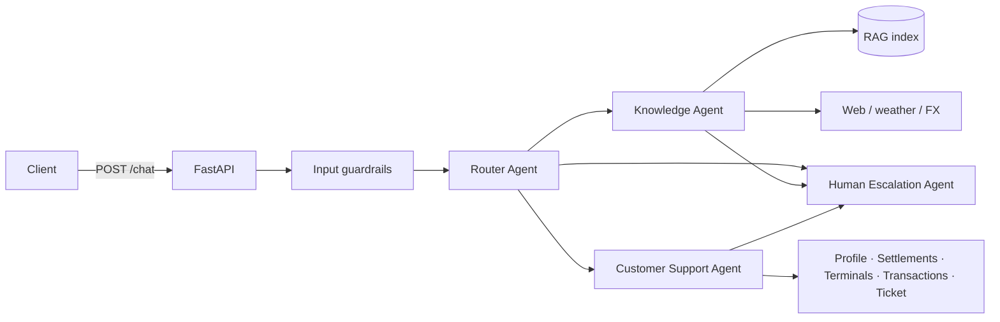

# Getnet Multi-Agent Support System

Multi-agent orchestration that answers Getnet merchants over a single HTTP endpoint:
a **Router Agent** plans the work, a **Knowledge Agent** answers from a RAG index of Getnet
pages (plus web tools for general questions), a **Customer Support Agent** resolves
merchant-specific issues with tools over the merchant's data, and a **Human Escalation Agent**
hands off to a human when the system can't resolve the request confidently.

Built with **Spec-Driven Development** — start with [`specs/`](specs/):

| Spec | Content |
|---|---|
| [00 — Context & Sources](specs/00-context-and-sources.md) | Problem, sources analysed, AI-vision implications, scenario → route map |
| [01 — Requirements](specs/01-requirements.md) | EARS requirements (REQ/NFR IDs), out of scope |
| [02 — Design](specs/02-design.md) | Architecture, agents, API contract, RAG pipeline, LLM layer, guardrails, decisions |
| [03 — Tasks](specs/03-tasks.md) | Task list with traceability to requirements and status |
| [04 — Testing & Evaluation](specs/04-testing-and-evaluation.md) | Test pyramid, orchestration integration testing, eval metrics, monitoring |
| [05 — Execution Plan](specs/05-execution-plan.md) | Phases & parallel sprints, file ownership, frozen interfaces, coverage matrix (brief + e-mail) |

> **Status:** first commit = specs + runnable skeleton (API, contracts, guardrails, support tools,
> router heuristics, human escalation, tests). Knowledge/RAG, LLM client and full agent logic are
> tracked in [`specs/03-tasks.md`](specs/03-tasks.md).

## Quick start

### Docker (recommended)

```bash
cp .env.example .env          # optional: set ANTHROPIC_API_KEY for LLM mode
docker compose up --build
```

```bash
curl -s -X POST localhost:8000/chat -H 'Content-Type: application/json' \
  -d '{"message": "When will the money from yesterday'"'"'s sales be deposited?", "user_id": "cliente1988"}'
```

OpenAPI docs: http://localhost:8000/docs · Health: http://localhost:8000/health

Plain Docker: `docker build -t getnet-agents . && docker run -p 8000:8000 --env-file .env getnet-agents`

### Local

```bash
make install        # venv + deps
make ingest         # build the RAG index
make run            # uvicorn on :8000
make test           # offline test suite (no key, no network)
./scripts/smoke.sh  # the 10 brief scenarios against a running API
```

## Configuration

| Variable | Default | Meaning |
|---|---|---|
| `LLM_MODE` | `auto` | `auto` uses Claude when a credential exists, else deterministic **offline** mode |
| `ANTHROPIC_API_KEY` | — | Claude credential |
| `LLM_MODEL` / `ROUTER_MODEL` | `claude-opus-5-5` / `claude-haiku-5-5` | Agent model / cheaper routing model |
| `INGEST_ONLINE` | `0` | `1` crawls the live Getnet pages at build time (else offline seed corpus) |
| `RAG_TOP_K`, `RAG_MIN_SCORE` | `4`, `0.08` | Retrieval parameters |
| `ESCALATION_CONFIDENCE` | `0.45` | Below this, the request is handed to a human |

## Architecture



**Message workflow:** input guardrails (PII masking, prompt-injection and harmful-request blocking)
→ Router produces a `RoutePlan` (ordered steps + confidence) → the orchestrator runs each step,
passing an `AgentContext` with previous step outputs (data flow between agents) → low confidence,
agent request or explicit ask triggers the Human Escalation Agent → JSON response with answer,
route, agents, tool calls, sources, confidence, escalation ticket, guardrail report and `trace_id`.

Details, RAG pipeline (ingestion → storage → retrieval → generation), LLM tool usage and design
decisions: [`specs/02-design.md`](specs/02-design.md).

## Testing

`pytest` runs fully offline. Strategy, orchestration integration testing approach, evaluation
metrics/gates and production monitoring: [`specs/04-testing-and-evaluation.md`](specs/04-testing-and-evaluation.md).
The golden dataset (10 brief scenarios + adversarial cases) lives in
[`tests/evals/scenarios.yaml`](tests/evals/scenarios.yaml).
