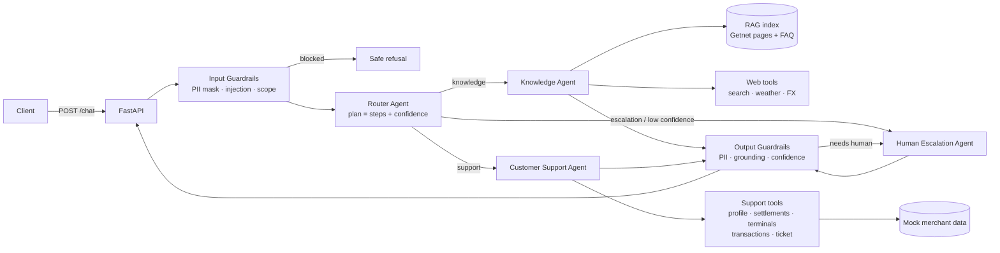

# 02 — Design

## 1. Architecture overview



### Communication mechanism

**In-process orchestration with typed messages** (direct function calls). The Router returns a
`RoutePlan` (ordered `steps`). The Orchestrator executes the steps and passes a shared
`AgentContext` (message, user_id, masked message, previous step outputs, trace) to each agent.
Each agent returns an `AgentResult` (answer, sources, tool_calls, confidence, needs_human).
Why: deterministic, easy to test and trace, zero infra. The `Agent` interface is transport-agnostic,
so the same contracts can move to a queue/event bus (e.g. SQS/Kafka) without touching agent logic.

## 2. Agents

| Agent | Responsibility | Tools | LLM usage |
|---|---|---|---|
| **Router** | Classify intent, produce plan (1..n steps), confidence, rationale | — | Structured output (`RoutePlan` schema). Offline: keyword/regex heuristics. |
| **Knowledge** | Getnet product Q&A grounded in RAG; general questions via web | `search_knowledge_base`, `web_search`, `get_weather`, `get_exchange_rate` | Tool-use loop; answers must cite sources. Offline: extractive answer from top chunks / direct tool output. |
| **Customer Support** | Resolve merchant-specific issues with the merchant's data | `get_customer_profile`, `get_settlement_schedule`, `get_terminal_status`, `get_recent_transactions`, `create_support_ticket` | Tool-use loop. Offline: intent → tool mapping + templated answer. |
| **Human Escalation** (bonus) | Structured handoff to a human operator | `create_handoff_ticket` | Template handoff (protocol + channels); LLM case summary for operators is a planned extension. |

### Multi-step plans

Router may chain agents, e.g. "machine won't connect" → `support` (terminal status for this user)
→ `knowledge` (official troubleshooting steps). The Knowledge step receives the Support output in
`AgentContext.previous` and the final answer is composed from both.

## 3. API contract

`POST /chat`

```json
{ "message": "When will the money from yesterday's sales be deposited?", "user_id": "cliente1988" }
```

Response (`ChatResponse`):

```json
{
  "trace_id": "4f1c…",
  "answer": "…",
  "route": "support",
  "agents": ["router", "support"],
  "sources": [{"title": "Dúvidas — Prazos", "url": "https://site.getnet.com.br/duvidas/…"}],
  "tool_calls": [{"tool": "get_settlement_schedule", "ok": true}],
  "confidence": 0.86,
  "escalated": false,
  "handoff_ticket": null,
  "guardrails": {"pii_masked": false, "blocked": false, "reason": null},
  "latency_ms": 412,
  "mode": "llm | offline"
}
```

Also: `GET /health` (liveness + index loaded + mode), `GET /docs` (OpenAPI).

## 4. RAG pipeline

1. **Ingestion** (`app/rag/ingest.py`, run at image build time or `python -m app.rag.ingest`): always load the
   curated seed corpus, and with `INGEST_ONLINE=1` (Docker default) crawl the URLs in `data/sources.yaml`
   (global site + BR product pages + BR FAQ; ~45 docs / ~350 chunks), strip nav/scripts with BeautifulSoup,
   normalise whitespace, keep `title` + `url`. Failed pages are skipped, so the seed is the offline fallback.
2. **Chunking**: ~800-char windows with ~150 overlap, split on headings/paragraphs first.
3. **Storage**: local persistent index (`data/index/`) — chunks JSON + vector matrix. Default
   retriever is **TF-IDF (char+word n-grams) + cosine**, offline and deterministic, good for PT/EN
   product names (Get Clássica, crediário). Pluggable `Retriever` interface to swap for dense
   embeddings / pgvector / OpenSearch in production.
4. **Seed corpus**: `data/seed/*.md` curated facts from the official pages (with URLs) so the
   system works even if the container has no internet at build time.
5. **Retrieval**: top-k (k=4) with score threshold; below threshold → "not found in KB" → web
   search or escalation.
6. **Generation**: LLM answers **only from the retrieved context**, cites URLs, says when it does
   not know. Offline: extractive answer (best sentences from top chunks) + sources.

## 5. LLM layer

`LLMClient` protocol with two implementations:

- `AnthropicLLM` — Anthropic Python SDK, model configurable via `LLM_MODEL`
  (default `claude-opus-5-5`; router can use a cheaper `ROUTER_MODEL`, e.g. `claude-haiku-5-5`).
  Router uses structured outputs (`messages.parse` with a Pydantic `RoutePlan`); agents use
  tool-use loops with a max-iterations budget.
- `OfflineLLM` — deterministic, no network. Selected automatically when no API credential is set
  (`LLM_MODE=auto|llm|offline`).

## 6. Guardrails

| Stage | Check | Action |
|---|---|---|
| Input | PII (CPF/CNPJ, card PAN, e-mail, phone) | Mask before LLM/logs (`***`). |
| Input | Prompt injection / jailbreak patterns | Block with safe message. |
| Input | Harmful / illegal / fraud requests (e.g. "how to clone a card") | Block. |
| Input | Empty / too long (> 2,000 chars) | 422 / reject. |
| Router | Out of scope (not Getnet and not general-info) | Polite redirect. |
| Output | PII leakage, missing sources for product claims, low confidence | Mask / add disclaimer / escalate. |
| Any | User asks for a human, legal/ombudsman, account cancellation, chargeback dispute | Human Escalation. |

## 7. Observability & evaluation (summary — details in 04)

- Structured JSON logs (one line per span) with `trace_id`, `agent`, `tool`, `latency_ms`, `route`,
  `escalated`, `mode`; `X-Trace-Id` response header.
- Metrics to monitor in production: routing accuracy, containment rate, escalation rate, guardrail
  block rate, tool error rate, p50/p95 latency, tokens/cost per request, groundedness score.
- Golden dataset (`tests/evals/scenarios.yaml`) used as a regression gate in CI.

## 8. Project layout

```
app/
  main.py            FastAPI app (POST /chat, GET /health)
  config.py          Settings (env)
  schemas.py         Pydantic contracts (ChatRequest/Response, RoutePlan, AgentResult…)
  orchestrator.py    Guardrails → Router → agents → output checks → response
  observability.py   JSON logging + trace spans
  llm/               LLMClient protocol, Anthropic + Offline implementations
  agents/            router.py, knowledge.py, support.py, escalation.py, base.py
  tools/             support_tools.py, web_tools.py
  rag/               ingest.py, store.py (index + retriever)
  guardrails/        input.py, output.py
  prompts/           *.md system prompts (versioned)
data/
  sources.yaml       URLs to ingest
  seed/              curated Getnet facts (offline corpus)
  mock/customers.json  mock merchant data
tests/               unit + API + eval tests
specs/               SDD documents
```

## 9. Key decisions (ADR-lite)

| # | Decision | Alternatives | Why |
|---|---|---|---|
| D1 | Python + FastAPI | Node/TS | Brief suggests it; best RAG/AI ecosystem; native OpenAPI. |
| D2 | Own lightweight orchestrator, typed contracts | LangGraph / CrewAI | Fewer deps, full control & traceability in a 60-min box; contracts map 1:1 to a LangGraph state graph later. |
| D3 | Anthropic Claude via official SDK, offline fallback | OpenAI, local LLM | Strong tool use + structured outputs; offline mode guarantees tests/demos without keys. |
| D4 | TF-IDF retriever behind an interface | Chroma + embeddings | No model download, deterministic, fast to build in Docker; swap-ready. |
| D5 | Mock repository behind tools | Real APIs | No real data available; tool interface is the integration seam. |
| D6 | Ingest BR site + FAQ in addition to getnet.net/en | Only suggested URL | Suggested URL lacks the products in the scenarios; brief asks for other sources. |
