# 05 — Execution Plan (phases, sprints, parallelism)

Time box: **60 min of core development** (e-mail). Session started ~03:04; Phase 0 closed at 03:27
(commit `61bc663`). Remaining budget ≈ **35 min** → plan below fits in 30 min + 5 min buffer.
Video and submission are outside the 60-min box.

## 1. Parallelism rules

1. **Contracts first, code second.** Every sprint codes against the interfaces in §4, so no sprint
   waits for another inside a phase.
2. **Disjoint file ownership.** Two parallel sprints never touch the same file (§3 lists owners).
   Shared files (`schemas.py`, `config.py`) are frozen during a phase; changes go through the
   integration sprint.
3. **Each sprint ends green:** its own tests pass + full `pytest` passes, then one commit
   (`feat(<sprint>): …`). Integration only starts when all sprints of the previous phase are green.
4. **Writer ≠ reviewer.** Phase 3 review is done by an independent read-only reviewer.

## 2. Phases and sprints

```mermaid
gantt
    dateFormat HH:mm
    axisFormat %H:%M
    section Phase 0
    S0 Specs + skeleton            :done, s0, 03:04, 23m
    section Phase 1 (parallel)
    S1 RAG pipeline                :s1, 03:30, 12m
    S2 LLM layer + prompts         :s2, 03:30, 12m
    S3 Support agent + web tools   :s3, 03:30, 12m
    section Phase 2 (parallel)
    S4 Knowledge agent             :s4, after s1, 10m
    S5 Router LLM + orchestration  :s5, after s2, 10m
    section Phase 3
    S6 Eval, smoke, review, README :s6, after s4, 8m
    section Outside 60 min
    S7 Video + submission          :s7, after s6, 30m
```



| Phase | Sprint | Scope | Tasks | Reqs | Done when |
|---|---|---|---|---|---|
| 0 | **S0** ✅ | SDD specs, skeleton, contracts, guardrails, support tools, router heuristics, escalation, tests, Docker | T-01..T-06 | REQ-01/08/09/10/11, NFR-01..04 | commit `61bc663`, 29 tests green, image builds |
| 1 | **S1 RAG** | Seed corpus `data/seed/*.md` (official facts + URLs), ingest (seed + optional crawl of `sources.yaml`), chunker, TF-IDF store persisted in `data/index/`, `Retriever.search` | T-08 | REQ-04/06 | `test_rag.py`: Get Smart / crediário 48x / Pix / antecipação queries return the right source |
| 1 | **S2 LLM** | `AnthropicLLM` (structured output + tool-use loop with iteration budget, timeouts), `OfflineLLM`, factory by `LLM_MODE`; prompts in `app/prompts/*.md` | T-14, T-15 | REQ-02/04/07, NFR-07/08 | `test_llm.py` with a scripted fake client exercising the tool loop |
| 1 | **S3 Support + Web** | Support agent: intent → tools (settlements, terminals, declined tx, ticket) offline; tool loop in LLM mode; web tools: `web_search` (DDGS), `get_weather` (Open-Meteo), `get_exchange_rate` (Frankfurter) | T-09, T-11 | REQ-05/07/08 | scenarios S03/S05/S08 call the expected tools; web tools tested with mocked HTTP |
| 2 | **S4 Knowledge** | RAG retrieval + citations; general questions → web/weather/FX; offline extractive answer; LLM grounded answer; "not found" → web or escalate | T-10 | REQ-04/05 | S01/S02/S04/S06/S07/S09/S10 answered with sources/tool output |
| 2 | **S5 Orchestration** | Router via LLM structured output + heuristic fallback; multi-step answer composition; output guardrails (PII leak, missing sources, low confidence → handoff) | T-07, T-13, T-12 | REQ-02/03/11/12 | multi-step S05/S08 compose support + knowledge; A01–A06 behave as expected |
| 3 | **S6 Verify & deliver** | Eval runner over golden set + metrics report; `docker compose up` + `scripts/smoke.sh`; independent code review; README final (build/run/test, architecture, workflow, RAG, LLM tools, eval & observability) | T-16..T-19 | REQ-13, NFR-01/05 | eval gates met (§04), smoke 10/10 = 200, review findings fixed |
| — | **S7 Submission** | Video ≤ 15 min (reasoning, architecture, orchestration demo), unlisted YouTube link, e-mail draft to stefany.morais@getnet.net | — | e-mail | links sent (by Eduardo) |

## 3. File ownership per sprint (no overlap inside a phase)

| Sprint | Owns (create/edit) | Reads only |
|---|---|---|
| S1 | `app/rag/*`, `data/seed/*`, `tests/test_rag.py` | `config.py`, `data/sources.yaml` |
| S2 | `app/llm/*`, `app/prompts/*`, `tests/test_llm.py` | `config.py`, `schemas.py` |
| S3 | `app/agents/support.py`, `app/tools/web_tools.py`, `tests/test_support_agent.py`, `tests/test_web_tools.py` | `app/tools/support_tools.py`, `schemas.py` |
| S4 | `app/agents/knowledge.py`, `tests/test_knowledge_agent.py` | S1, S2, S3 outputs |
| S5 | `app/agents/router.py`, `app/orchestrator.py`, `app/guardrails/output.py`, `tests/test_orchestration.py` | S2 outputs |
| S6 | `tests/evals/test_eval.py`, `README.md`, `specs/03-tasks.md`, fixes from review | everything |

## 4. Interfaces frozen for Phase 1 (contracts between sprints)

```python
# S1 — app/rag/store.py
@dataclass
class Chunk: text: str; title: str; url: str; score: float = 0.0
class Retriever(Protocol):
    def search(self, query: str, k: int = 4) -> list[Chunk]: ...
def get_retriever() -> Retriever          # loads data/index/, builds from seed if missing

# S2 — app/llm/client.py
class LLMClient(Protocol):
    mode: str                              # "llm" | "offline"
    def structured(self, system: str, user: str, schema: type[BaseModel], model: str | None = None) -> BaseModel: ...
    def run_tools(self, system: str, user: str, tools: list[dict], execute: Callable[[str, dict], dict],
                  model: str | None = None) -> tuple[str, list[ToolCall]]: ...
def get_llm() -> LLMClient
def load_prompt(name: str) -> str          # app/prompts/<name>.md

# S3 — app/tools/web_tools.py
def web_search(query: str, max_results: int = 5) -> dict
def get_weather(city: str, day_offset: int = 1) -> dict
def get_exchange_rate(base: str, quote: str = "BRL") -> dict
WEB_TOOLS: dict[str, tuple[Callable, dict]]   # same shape as SUPPORT_TOOLS
```

## 5. How we run the parallel sprints

- **Phase 1:** three implementer subagents in parallel (S1, S2, S3), each with its own git worktree
  and the file-ownership list above as its scope; main thread merges the three branches into `main`
  (no conflicts by construction) and runs the full suite.
- **Phase 2:** two implementer subagents in parallel (S4, S5) on top of the merged Phase 1.
- **Phase 3:** main thread runs eval + Docker smoke; an independent read-only reviewer audits the
  diff; fixes are applied by the writer, re-verified, then final commit.
- Fallback if parallel execution misbehaves: run sprints sequentially in the same order
  (S1 → S3 → S2 → S4 → S5 → S6); the contracts don't change.

## 6. Coverage matrix — brief + e-mail → where it is satisfied

| # | Requirement (source) | Sprint | Evidence |
|---|---|---|---|
| 1 | Use Spec-Driven Development (brief + e-mail) | S0 | `specs/00..05`, task ↔ requirement traceability |
| 2 | ≤ 60 min core development per attempt (e-mail) | all | this plan's time box; commit timestamps |
| 3 | ≥ 3 distinct agent types + communication mechanism (brief §1) | S0, S5 | Router, Knowledge, Support (+ Escalation); `AgentContext`/`RoutePlan` in-process messaging |
| 4 | Router: entry point, decides agent or sequence, manages data flow (brief §1) | S0, S5 | `RoutePlan.steps`, `AgentContext.previous`, S05/S08 multi-step tests |
| 5 | Knowledge: RAG grounded on getnet.net + other sources (brief §1) | S1, S4 | `data/sources.yaml`, seed corpus, citations in response |
| 6 | Knowledge: web search tool for general questions (brief §1) | S3, S4 | `web_search`, `get_weather`, `get_exchange_rate`; S02/S07 |
| 7 | Support: retrieves user data, ≥ 2 tools (brief §1) | S0, S3 | 5 tools in `support_tools.py`; S03/S05/S08 |
| 8 | HTTP POST endpoint with `message` + `user_id`, meaningful JSON (brief §2) | S0 | `POST /chat`, `ChatResponse` |
| 9 | Dockerfile (+ compose) runs with standard commands (brief §3) | S0, S6 | `docker compose up --build`, smoke script |
| 10 | Testing strategy + integration testing approach for orchestration (brief §4) | S0, S6 | `specs/04`, pytest suite, eval runner |
| 11 | Suitable language/libs for API, agents, RAG (brief §5) | S0 | Python, FastAPI, Anthropic SDK, scikit-learn; rationale in `specs/02` §9 |
| 12 | Clean, modular code; high-quality prompts; functional RAG ingesting the URLs (brief "looking for") | S1, S2, S6 | module per concern; `app/prompts/*.md`; `test_rag.py`; review |
| 13 | Evaluation, observability, reliability, guardrails, monitoring (brief "looking for") | S0, S5, S6 | JSON spans, trace id, guardrails, eval gates, monitoring plan (`specs/04`) |
| 14 | README: build/configure/run/tests (brief) | S6 | README Quick start / Configuration / Testing |
| 15 | README: architecture, design choices, workflow, RAG pipeline, LLM tools (brief) | S6 | README + `specs/02` |
| 16 | Bonus: 4th agent (human escalation) | S0, S5 | `EscalationAgent`, handoff ticket |
| 17 | Bonus: guardrails (unsafe, irrelevant, sensitive, unsupported) | S0, S5 | input/output guardrails, A01–A05 |
| 18 | Bonus: redirect / human handoff on low confidence | S0, S5 | `ESCALATION_CONFIDENCE`, `needs_human`, A03/A06 |
| 19 | Bonus: evaluation & observability strategy (dashboards, traces, logs, datasets, regression, alerts) | S6 | `specs/04` §3–4, `tests/evals` |
| 20 | 10 example scenarios work (brief) | S3–S6 | golden set + smoke 10/10 |
| 21 | GitHub repo link (brief + e-mail) | S0 | public repo `EduPereiraDev/getnet-multi-agent-support` |
| 22 | Video ≤ 15 min, unlisted YouTube: reasoning, architecture, orchestration (brief + e-mail) | S7 | link in submission e-mail |
| 23 | Send repo + video links to stefany.morais@getnet.net within 1 week (e-mail) | S7 | e-mail sent by Eduardo |
| 24 | Multiple attempts allowed; submit the best complete one (e-mail) | S7 | tag `submission` on the chosen commit |

## 7. Risks and mitigations

| Risk | Mitigation |
|---|---|
| Time box overrun | Scope cut order: LLM-judge eval → online crawl → FX/weather polish; never cut tests, Docker, README |
| No LLM credential in the evaluator's machine | Offline mode is a first-class path, tested in CI and in Docker |
| Getnet pages change / block crawling | Seed corpus with URLs ships in the repo; online crawl is optional |
| Free web APIs down (DDGS/Open-Meteo/Frankfurter) | Timeouts + graceful message; tests use mocked HTTP |
| Merge conflicts between parallel sprints | Disjoint file ownership + frozen contracts (§3–4) |
